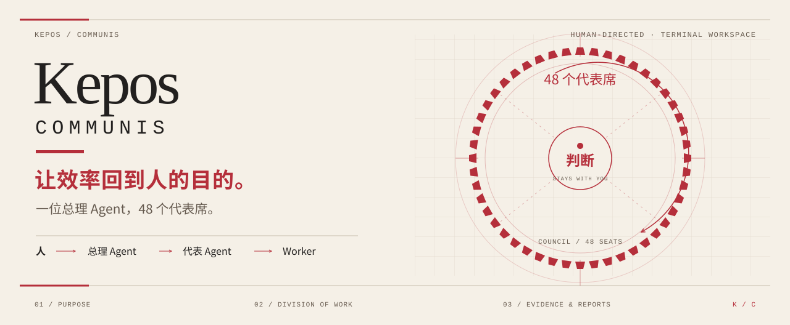

<p align="center">
  
</p>

<p align="center">
  <strong>One premier agent, one council, one terminal.</strong><br>
  You set the goal; the premier delegates across the council. Direction and key decisions stay with you.
</p>

<p align="center">
  
  
  
  <a href="LICENSE"></a>
</p>

<p align="center">
  <a href="#install"><strong>Install</strong></a> &nbsp;/&nbsp;
  <a href="#features">Features</a> &nbsp;/&nbsp;
  <a href="#keys">Keys</a> &nbsp;/&nbsp;
  <a href="#architecture">Architecture</a> &nbsp;/&nbsp;
  <a href="README.md">中文</a> &nbsp;/&nbsp;
  <a href="docs/README.md">Docs</a>
</p>

<!-- Screenshot slot: docs/screenshots/hero-demo.gif — uncomment once recorded:
<p align="center"></p>
-->

<a id="install"></a>
## Install

Requires Node.js 24+. On Windows, run inside Windows Terminal; when started from a legacy console the program relaunches itself there. The Windows x64 package bundles fd and ripgrep, so the first start downloads nothing.

```bash
npm install -g https://github.com/Libidooo/kepos-communis/releases/download/v0.5.1/kepos-communis-0.5.1.tgz
kepos
```

From source:

```bash
git clone https://github.com/Libidooo/kepos-communis.git
cd kepos-communis
npm ci --ignore-scripts
npm start
```

On first start, run `/login` to configure a model provider and `F4` to choose the premier's model. Model calls use your own account and incur costs. `kepos doctor` checks the runtime environment; a `npm warn deprecated node-domexception` line during install comes from an upstream dependency and is harmless.

<details>
<summary><strong>Data directory and local builds</strong></summary>

The default data directory is `~/.kepos`; isolate setups with `kepos --home <dir>`. The source launcher rebuilds on source changes. Build an installable archive with `npm pack`. Releases are listed under [Releases](https://github.com/Libidooo/kepos-communis/releases). See the [installation guide](docs/installation.md) for checksums, relay endpoints and troubleshooting.

</details>

<a id="features"></a>
## Features

### Council

Seats default to 48 and are configurable via `config.councilSize`. The seats form a single ring; a red five-pointed star marks the premier. Seat glyphs carry state: running ◉, queued ◔, idle ◌, failed ⊘. Work groups gather into their own small rings. Clicking a seat opens that representative's task desk in the middle column.

### Desk

Three panes: seats on the left, the conversation in the middle, projects and sessions on the right. Tool output and thinking fold and unfold on click. The approval-mode chip in the status bar switches regimes on click. When the transcript overflows, a scroll track appears on the right.

### Approval

| Mode | Behaviour |
| --- | --- |
| ⛨ Strict | Gates and Kepos data are human-only; every budget increase is approved case by case |
| ⚖ Proxy | The premier may approve gates after checking evidence; budget increases within 2M tokens per task are decided by the premier with an audit trail, beyond that they go to the human |
| ⊙ Readonly | Mutating tools are removed; observe and report |

When a task hits its budget, the approval window moves to the front: approve at the suggested amount, set a custom amount, or refuse.

### Dispatch control

- Every batch is checked against the model registry before dispatch; seats with dead providers are refused by name
- Batches cap at 8 concurrent dispatches (`config.maxBatchConcurrency`)
- Budgets scale with task difficulty: lookups ≥20k, ordinary 50k, deep analysis 100k–200k tokens
- File-reading tasks get their paths whitelisted via `readAllow`; judgement tasks are instructed to answer directly

### Memory and workflows

Representative memory is bitemporal: corrections mark rows invalid, history stays queryable. Repeated practices surface as skill proposals. A collaboration's roster and mandates can be saved as a workflow template and re-instantiated in one step.

### Task archive

Every task files brief, transcript, report and decision documents plus an index. A representative can read its own branch's archive and cannot read other representatives' conclusions, keeping judgements independent.

<a id="keys"></a>
## Keys

| Key | Action |
| --- | --- |
| `Enter` | Send; in the council, open the selected seat's desk |
| `F1` | Help |
| `F2` | Menu (sessions & projects / seats & roster / tasks & approvals / system) |
| `F3` / `F8` | Session tasks / cross-project tasks |
| `F4` | Switch the premier's model; the choice persists across restarts |
| `F5` / click | Fold and unfold tool output |
| `F6` | Cycle pane focus |
| `F7` / `/copy` | Copy the latest full answer |
| `F9` / `F10` | Long-range plans / council |
| `F11` | Collapse side panes for reading |
| `Tab` | Council: switch between ring and task list |
| `/` / `v` | Council list: filter / read full output |
| `Ctrl+K` | Command palette |
| `Ctrl+X` | Abort the running turn; in the council, cancel the selected task |
| `Ctrl+End` | Jump to the latest message |
| `PgUp/PgDn` · wheel | Scroll history |
| `Esc` | Back out one level |

Scrolling back pauses follow mode and does not affect running tasks.

<a id="architecture"></a>
## Architecture

Kepos is built on the Pi SDK: Pi handles models, authentication and sessions; Kepos handles seat configuration, the worker pool, long-range plans, run records and the interface.

```text
TUI workbench ── Pi SDK ── model providers
    └─ seat config / WorkerPool / MissionScheduler

CLI ─────────── auth, diagnostics, plan ops
daemon ──────── local RPC / leases / pool

pool ────────── subordinate executors ── task results
    ├─ Pi JSONL: raw sessions
    └─ SQLite: tasks, plans, events, receipts, usage
```

| Mechanism | Notes |
| --- | --- |
| Worker pool | Concurrency cap 48, independent of seat count; per-session queuing, context cleared before process reuse |
| Long-range plans | DAG steps and dependencies; 5-minute default, steps beyond 20 minutes require approval, 60-minute per-step cap |
| Run evidence | Paged reads; result hashes, terminal receipts and per-task token usage |
| Permissions | Three approval regimes, read scopes, environment allowlists, per-task MCP grants |

The TUI, CLI and daemon do not yet share one pool; unified scheduling is in progress — see the [architecture doc](docs/architecture.md).

### Limits

- Permissions on configured MCP servers need separate review
- After a process restart some tasks require manual verification
- Terminal tasks are pruned per the [retention policy](docs/retention.md); back up important outputs

Full constraints are listed in [SECURITY.md](SECURITY.md).

## Docs & development

| Using | Engineering |
| --- | --- |
| [Installation](docs/installation.md) · [Product](docs/product.md) | [Architecture](docs/architecture.md) · [Unified scheduling](docs/unified-scheduling.md) |
| [Daemon](docs/daemon.md) · [Remote workers](docs/remote-worker.md) | [Graph contract](docs/graph-contract.md) |
| [Retention](docs/retention.md) · [Security](SECURITY.md) | [Release checks](docs/release.md) |

```bash
npm ci --ignore-scripts
npm run typecheck
npm test
```

---

<p align="center">
  <sub>Kepos means garden · MIT License · <a href="THIRD_PARTY_NOTICES.md">third-party notices</a></sub>
</p>
