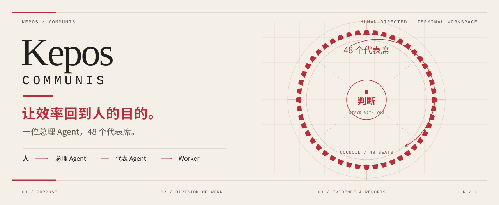
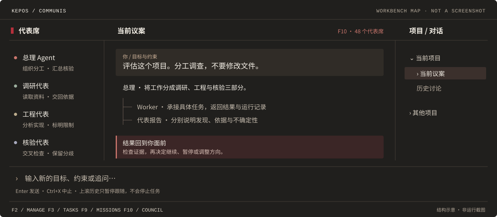

<p align="center">
  
</p>

<p align="center">
  <strong>一位总理 Agent，一座议会，一个终端。</strong><br>
  你提出目标，总理调度代表分工；工作的方向与关键决定，始终在你手里。
</p>

<p align="center">
  
  
  
  <a href="LICENSE"></a>
</p>

<p align="center">
  <a href="#install"><strong>开始使用</strong></a> &nbsp;/&nbsp;
  <a href="#features">特性</a> &nbsp;/&nbsp;
  <a href="#workspace">工作台</a> &nbsp;/&nbsp;
  <a href="#architecture">架构</a> &nbsp;/&nbsp;
  <a href="README.en.md">English</a> &nbsp;/&nbsp;
  <a href="docs/README.md">文档</a>
</p>

<!-- 截图位：docs/screenshots/hero-demo.gif —— 15–25 秒完整流程演示（splash → 议案 → 议会 → 书案 → 审批），拍好后取消注释：
<p align="center"></p>
-->

<a id="install"></a>
## 🚀 开始使用

需要 **Node.js 24+、npm 和 Git**。支持 Windows、macOS 和 Linux。

```bash
git clone --branch codex/tui-refresh https://github.com/Libidooo/kepos-communis.git
cd kepos-communis
npm ci --ignore-scripts
npm start
```

进入工作台后，`/login` 配置模型服务商，`F4` 选模型，然后像这样开口：

> 调研这个项目，分成架构、风险和文档三部分，不要修改文件。

`F10` 看代表分工，`F3` 看任务结果，`F9` 看长程计划。模型调用使用你自己的账户，可能产生费用。

<details>
<summary><strong>安装 .tgz 包、版本说明与数据目录</strong></summary>

### 安装包

已有本地 `.tgz` 时，可以直接安装：

```bash
npm install -g ./kepos-communis-0.5.1.tgz
kepos doctor --json
kepos
```

要从源码生成该包，在完成依赖安装的项目目录运行 `npm pack`。包内含编译产物、主题和文档，不捆绑 Node.js 或全部依赖，首次安装通常需要联网。

### 获取版本

| 入口 | 内容 |
| --- | --- |
| [公开 Release v0.5.1](https://github.com/Libidooo/kepos-communis/releases/latest) | 附 `kepos-communis-0.5.1.tgz` 安装包与发布说明 |
| 源码 | `main` 分支即发布版本 |

### 数据目录

默认数据目录是 `~/.kepos`。试用或多套配置可用 `kepos --home <directory>` 隔离；源码启动器会在源码变化时重新构建，因此需保留开发依赖。

校验值、中转端点、凭据和排错见[安装指南](docs/installation.md)。

</details>

<a id="features"></a>
## ✨ 特性

### 🏛 议会 · 一环如徽

议会席位**默认 48 席**（`config.councilSize` 可调，不是上限），默认环绕成一圈——和 logo 同形。红色五角星居中为总理；席位符号自带状态语义（呼吸 ◉ 运行、◔ 排队、◌ 待命、⊘ 失败），工作小组自动聚成小环，谁在和谁协作一眼可辨。点击任意席位，中栏即开它的书案。

<!-- 截图位：docs/screenshots/council.png
<p align="center"></p>
-->

### 🗳 议案 · 你的工作台

三栏布局：左侧代表席，中间与总理的对话（你的消息带琥珀色左缘条，一眼可辨），右侧项目与会话。工具输出与思考过程**点击即折叠/展开**；审批模式芯片常驻状态栏，点击即切换。

<!-- 截图位：docs/screenshots/desk.png
<p align="center"></p>
-->

### 🔐 三档审批 · 主权在你

| 模式 | 行为 |
| --- | --- |
| **⛨ 严格** | 门禁与 Kepos 数据只有你能动；代表预算追加逐案弹窗审批 |
| **⚖ 代理** | 总理自查证据后可批准门禁；单任务预算追加（≤2M）总理评估即生效、留痕可查，超出才呈报你 |
| **⊙ 只读** | 模型没有写入工具，只查看与汇报 |

预算截停的审批**自动弹到最前**——一键批准 / 自定义额度 / 拒绝，不再翻五层菜单。

### 🧰 派发治理 · 用真实演习换来的规矩

- **批量预检**：派发前零成本核对每个席位的模型是否在线，失效席位点名拒绝
- **单批 ≤8 路**：并发限流实测边界固化，一批出事只损失一批
- **预算分层**：轻查询 ≥20k、常规 50k、深度分析 100k–200k，重型席位直接给宽
- **证据白名单**：需要读文件的任务配 `readAllow`，推演任务声明“直接作答”——不让代表空转烧钱

### 📚 记忆 · 技能 · 工作流

代表的记忆双时态（修正只标记失效，历史可回溯）；重复出现的做法自动提议沉淀为技能；一次真实协作的编制与任务书可存为**工作流模板**，下次一键实例化。

### 🗄 归档宪法

每个任务留下 `brief / transcript / report / decision` 四件套与索引。代表能读自己分支的档案以知道“过去遇到了什么”，读不到彼此的结论——独立判断不被附和污染。

<details>
<summary><strong>更多能力：选举 · 借调 · 长程计划 · 观察值守</strong></summary>

- **代理总代**：组内推举 → 总理核阅候选人履历 → 你批准；兼任治理复核，不占席位
- **跨组借调**：仅代理总代可发起、总理静默批准、一小时内自动收回——借调不扩权
- **长程计划**：DAG 步骤 + 验收条目（完成 ≠ 通过，未勾满记为提前完成）
- **观察值守**：文件事件监听派发，默认全关，开了观察才有派发

</details>

<a id="workspace"></a>
## 🖥 工作台

<p align="center">
  
</p>

| 常用入口 | 操作 |
| --- | --- |
| `F2` | 分组操作菜单（对话与项目 / 代表与编制 / 任务与审批 / 系统） |
| `F3` / `F8` | 当前会话任务 / 跨项目任务 |
| `F9` / `F10` | 长程计划 / 议会环图 |
| `Ctrl+X` | 议案中止整轮；议会取消选中任务 |
| `PgUp/PgDn` · 滚轮 | 回翻历史（状态栏提示已暂停跟随） |

<details>
<summary><strong>全部快捷键</strong></summary>

| 按键 | 操作 |
| --- | --- |
| `Enter` | 输入区发送；议会席位/列表焦点下打开书案 |
| `F1` | 帮助 |
| `F4` | 切换总理模型（选择会被记住，重启沿用） |
| `F5` / 点击 | 展开 / 折叠工具输出（整类切换） |
| `F6` | 切换面板焦点 |
| `F7` / `/copy` | 复制最新完整回答 |
| `F11` | 收起侧栏，专注阅读 |
| `Tab` | 议会内切换席位图 / 任务列表 |
| `/` / `v` | 议会列表内过滤 / 阅读完整产出 |
| `Ctrl+K` | 命令面板 |
| `Ctrl+End` | 回到最新并恢复跟随 |
| `Esc` | 逐层返回 |

上滚历史只暂停跟随，不会中止任务。关闭当前窗口不代表独立 daemon 或远程任务已停止。

</details>

<a id="architecture"></a>
## 🏗 架构

Kepos 基于 **Pi SDK**：Pi 负责模型、认证与会话运行；Kepos 负责代表配置、执行池、长程计划、运行记录与协作界面。

```text
TUI 工作台 ── Pi SDK ── 模型服务商
    └─ 代表配置 / WorkerPool / MissionScheduler

CLI ───────── 认证、诊断、计划操作 / 本地运行
daemon ────── 本地 RPC / 租约 / 自有执行池

各执行池 ──── 僚属执行进程 ── 任务结果
    ├─ Pi JSONL：原始会话
    └─ SQLite：任务、计划、事件、回执、用量
```

| 机制 | 做法 |
| --- | --- |
| **执行池** | 并发上限 48（席位数是另一回事：默认 48、可配置）；同会话按序排队，会话间轮转，复用热进程前清空上下文 |
| **长程计划** | DAG 步骤与依赖；默认任务 5 分钟，超 20 分钟进入审批，单步最长 60 分钟 |
| **运行证据** | 短预览 + 分页读取；结果哈希、终态回执、逐任务 token 用量 |
| **权限控制** | 三档审批、读取范围、环境变量白名单、按任务授予的 MCP 权限 |
| **取消与清理** | 记录取消请求与退出状态；失败保留错误及已有产出 |

TUI、CLI 与 daemon 尚未共用一个执行池；**48 并发是单池上限**，统一调度迁移仍在进行。详见[工程架构](docs/architecture.md)与[统一调度设计](docs/unified-scheduling.md)。

### 使用边界（Beta）

- 默认严格审批会对门禁与 Kepos 数据操作请求确认；已配置 MCP 的权限需另行检查
- 计划可保存重看；无法确认的派发不会自动重放，进程重启后部分任务需人工核对
- 报告内容仍需核验；超龄终态任务按[保留策略](docs/retention.md)清理，重要产出请单独备份
- 取消请求不等于远端进程已确认退出

详细约束见 [SECURITY.md](SECURITY.md)。

<a id="development"></a>
## 📖 文档与开发

| 使用 | 工程 |
| --- | --- |
| [安装指南](docs/installation.md) · [产品说明](docs/product.md) | [架构与实现](docs/architecture.md) · [统一调度](docs/unified-scheduling.md) |
| [daemon](docs/daemon.md) · [远程 Worker](docs/remote-worker.md) | [图谱契约](docs/graph-contract.md) · [画布](canvas/README.md) |
| [归档与保留](docs/retention.md) · [安全说明](SECURITY.md) | [发布检查](docs/release.md) · [全部文档](docs/README.md) |

```bash
npm ci --ignore-scripts
npm run typecheck   # 类型检查
npm test            # 全量测试（584 项）
npm run test:terminal:sdk   # Windows 终端实机验证
```

`npm run test:live` 调用真实模型、可能产生费用，不在默认范围。

---

<p align="center">
  <sub>Kepos，意为花园。</sub><br>
  <sub>MIT License · 第三方许可见 <a href="THIRD_PARTY_NOTICES.md">THIRD_PARTY_NOTICES</a></sub>
</p>
