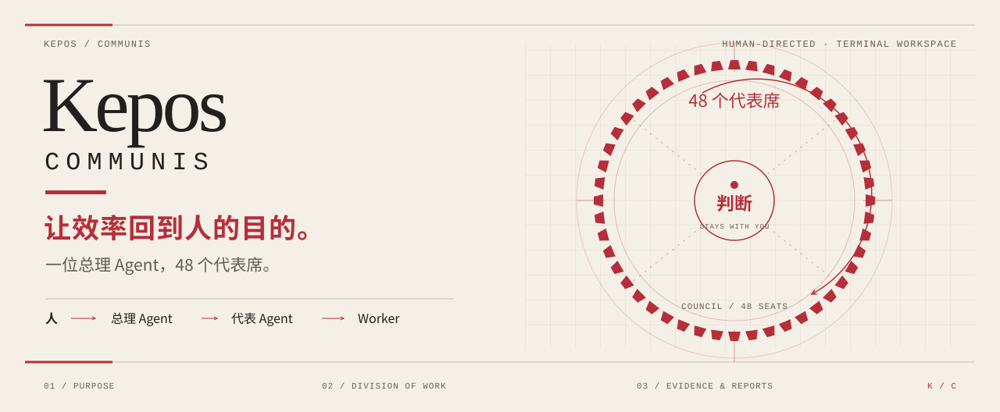
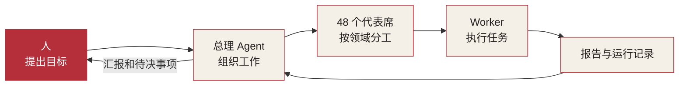
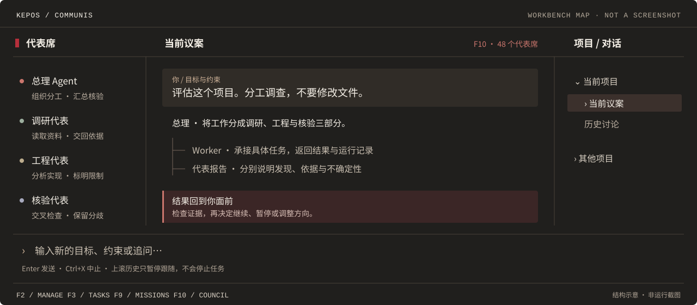

<p align="center">
  
</p>

<p align="center">
  <a href="#install"><strong>开始使用</strong></a> &nbsp; / &nbsp;
  <a href="#product">48 个代表席</a> &nbsp; / &nbsp;
  <a href="#workspace">工作台</a> &nbsp; / &nbsp;
  <a href="#architecture">工程架构</a> &nbsp; / &nbsp;
  <a href="docs/README.md">文档</a>
</p>

<p align="center">
  
  
  <a href="LICENSE"></a>
</p>

**Kepos 是人调度 Agent 进行分工工作的终端空间**。你提出目标，总理 Agent 安排代表分工，Worker 执行具体任务。报告、结果和运行记录都能在同一张工作台中查阅。

一位总理 Agent，**48 个代表席**。代表的职责、模型和 Skill 可以分别配置，调研、工程、核验等工作可以同时推进。工作的方向和关键决定仍由你掌握。

<a id="install"></a>
## 开始使用

需要 **Node.js 24+、npm 和 Git**。支持 Windows、macOS 和 Linux，无需另外安装全局 Pi。

```bash
git clone --branch codex/tui-refresh https://github.com/Libidooo/kepos-communis.git
cd kepos-communis
npm ci --ignore-scripts
npm start
```

进入工作台后，输入 `/login` 配置模型服务商，用 `F4` 选择模型，再描述目标。例如：

> 调研这个项目，分成架构、风险和文档三部分，不要修改文件。

按 `F10` 看代表分工，`F3` 看任务结果，`F9` 看长程计划。模型调用使用你的账户，可能产生费用。

<details>
<summary><strong>安装 .tgz 包、版本说明与数据目录</strong></summary>

### 安装包

已有本地 `.tgz` 时，可以直接安装：

```bash
npm install -g ./kepos-communis-0.3.0-beta.5.tgz
kepos doctor --json
kepos
```

要从源码生成该包，在完成依赖安装的项目目录运行 `npm pack`。包内含编译产物、主题和文档，不捆绑 Node.js 或全部依赖，首次安装通常需要联网。

### 获取版本

| 入口 | 内容 |
| --- | --- |
| 当前开发分支 | `codex/tui-refresh`，版本 `0.3.0-beta.5` |
| [公开 Release](https://github.com/Libidooo/kepos-communis/releases/latest) | 截至 2026-10-31，最新为 `v0.3.0-beta.4`，提供源码归档，尚无安装附件 |
| 本地 `.tgz` | 从当前源码构建，不等同于公开 Release |

### 数据目录

默认数据目录是 `~/.kepos`。试用或多套配置可用 `kepos --home <directory>` 隔离；源码启动器会在源码变化时重新构建，因此需保留开发依赖。

校验值、中转端点、凭据和排错见[安装指南](docs/installation.md)。

</details>

<a id="product"></a>
## 48 个代表席

代表按领域承担工作，总理负责安排与汇总。你可以查看每位代表的任务、状态和报告，也可以直接筛选失败或等待处理的任务。

| 角色 | 分工 |
| --- | --- |
| **人** | 提出目标与约束，检查结果，决定下一步 |
| **总理 Agent** | 拆解任务、安排代表、汇总报告、核对依据 |
| **代表 Agent** | 负责调研、规划、工程、风险、核验等领域 |
| **Worker** | 执行具体委派，返回产出、错误和运行记录 |

默认预置 **10 个常用代表**，可以调整或为任务临时创建。48 席按需使用，单个执行池最多并行处理 **48 项任务**，其余排队。

<details>
<summary>查看分工与报告流向</summary>



代表是工作职责，Worker 是执行单元。当前由总理发起委派，复制委派最多一层，不会由子任务无限派生。详细说明见[产品文档](docs/product.md)。

</details>

<a id="workspace"></a>
## 工作台

<p align="center">
  
</p>

*布局示意，非运行截图。*

左侧查看代表，中间与总理交谈和阅读报告，右侧切换项目与历史会话。`F10` 议会提供席位图和任务列表两种视图。

| 常用入口 | 操作 |
| --- | --- |
| `F2` | 管理项目、代表、任务和审批模式 |
| `F3` / `F8` | 查看当前会话任务 / 跨项目任务 |
| `F9` / `F10` | 查看长程计划 / 打开议会 |
| `Ctrl+X` | 议案中止总理与本进程子任务；议会中取消选中任务 |

<details>
<summary>其他快捷键</summary>

| 按键 | 操作 |
| --- | --- |
| `Enter` | 输入区发送；议会席位或列表焦点下打开详情 |
| `F1` | 帮助 |
| `F4` | 切换总理 Agent 模型 |
| `F5` | 展开 / 折叠工具输出 |
| `F6` | 切换面板焦点 |
| `F7` / `/copy` | 复制最新完整回答 |
| `F11` | 收起侧栏，专注阅读 |
| `Tab` | 议会内切换席位图 / 任务列表 |
| `/` / `v` | 议会列表内过滤 / 阅读完整产出 |
| `Ctrl+K` | 命令面板 |
| `Ctrl+End` | 回到最新消息，恢复跟随 |
| `Esc` | 逐层返回 |

上滚历史只暂停跟随，不会中止任务。关闭当前窗口不代表独立 daemon 或远程任务已停止，请查看对应任务状态。

</details>

<a id="architecture"></a>
## 工程架构

Kepos 基于 **Pi SDK**。Pi 负责模型、认证和会话运行；Kepos 负责代表配置、执行池、长程计划、运行记录和协作界面。

TUI、CLI 和 daemon 目前并未全部共用一个执行池。**48 项并发是单池上限**，跨入口统一调度已有 RPC 基础，迁移仍在进行。

<details>
<summary>组件与数据流</summary>

```text
TUI 工作台 ── Pi SDK ── 模型服务商
    └─ 代表配置 / WorkerPool / MissionScheduler

CLI ───────── 认证、诊断、计划操作 / 本地运行
daemon ────── 本地 RPC / 租约 / 自有执行池

各执行池 ──── Worker 进程 ── 任务结果
    │
    ├─ Pi JSONL：原始会话
    └─ SQLite：任务、计划、事件、回执、图投影
                       │
                  监控与证据读取
```

组件关系、数据归属和源码入口见[工程架构](docs/architecture.md)，迁移计划见[统一调度设计](docs/unified-scheduling.md)。

</details>

<a id="mechanisms"></a>
### 实现方法

<details>
<summary>代表配置、48 槽执行池、长程计划与权限</summary>

| 机制 | 做法 |
| --- | --- |
| **代表配置** | 接受委派时保存角色、模型、工具与 Skill 快照，关联配置修订 |
| **48 槽执行池** | 同一会话内按顺序排队，会话间轮转；复用热进程前清空上下文 |
| **长程计划** | Mission 用 DAG 保存步骤和依赖；默认任务时限 5 分钟，超过 20 分钟的步骤进入审批，单步最长 60 分钟 |
| **运行证据** | 提供短预览和分页读取，保存结果哈希、终态回执与任务事件 |
| **权限控制** | 三态审批、读取范围、环境变量白名单和按任务授予的 MCP 权限 |
| **取消与清理** | 记录取消请求和退出状态，失败时保留错误及已有产出 |

</details>

<a id="boundaries"></a>
### 使用边界

当前仍在 Beta 阶段。统一执行池、全局预算和跨机器路由尚需完善；长程计划的恢复与远程任务的取消需要核对实际状态。

<details>
<summary>审批、恢复与证据保留的具体限制</summary>

- 默认严格审批会对涉及门禁或 Kepos 数据的操作请求确认；代理审批允许模型批准门禁。只读监督移除常见修改工具，已配置 MCP 的权限需另行检查。
- 计划可以保存和重新查看；无法确认的派发不会自动重放。进程重启后，部分任务需要人工核对。
- 回执和哈希记录运行结果，报告内容仍需核验。超龄终态任务会按[保留策略](docs/retention.md)清理，重要产出请单独备份。
- 取消请求不等于远端进程已确认退出。

详细约束见 [SECURITY.md](SECURITY.md)。

</details>

<a id="development"></a>
## 文档与开发

| 使用 | 工程 |
| --- | --- |
| [安装指南](docs/installation.md) · [产品说明](docs/product.md) | [架构与实现](docs/architecture.md) · [统一调度](docs/unified-scheduling.md) |
| [daemon](docs/daemon.md) · [远程 Worker](docs/remote-worker.md) | [图谱契约](docs/graph-contract.md) · [画布](canvas/README.md) |
| [归档与保留](docs/retention.md) · [安全说明](SECURITY.md) | [发布检查](docs/release.md) · [全部文档](docs/README.md) |

<details>
<summary>开发命令与测试范围</summary>

```bash
npm ci --ignore-scripts
npm run typecheck
npm test
npm run test:package
npm run audit:public
```

CI 配置覆盖 Ubuntu、Windows、macOS / Node 24 的类型检查、核心测试、打包预览和公开仓库审计。`test:package` 检查包内文件及文档链接，并用隔离数据目录运行包内 `doctor`；它复用项目依赖，干净机器安装需另行验证。

Windows 终端交互另跑 `npm run test:terminal:sdk`，旧回归见 `npm run test:legacy`。`npm run test:live` 会调用真实模型并可能产生费用，不在默认测试范围内。

</details>

---

Kepos，意为花园。项目采用 [MIT License](LICENSE)，第三方许可见 [THIRD_PARTY_NOTICES.md](THIRD_PARTY_NOTICES.md)。
