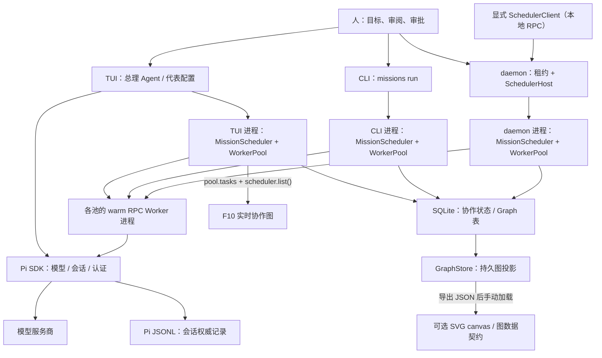

# 架构

本文说明 `0.3.0-beta.5` 的主要组件、调度方法和数据存储。尚未完成的工作列在文末。

## 职责

Kepos 的工作台有一位总理 Agent 和 48 个代表席。人提出目标，总理组织代表分工，Worker 执行具体任务，结果由总理汇总后交给人。

总理对应主 Pi 会话，代表对应职责、模型和 Skill 等配置（profile），Worker 是实际执行单元。同一代表配置可以用于多项任务。首次预置十个代表，按需派发任务，不会默认启动 48 个后台进程。

结果由总理 Agent 汇总、核对，再交给人判断。当前复制委派由主 Agent 发起，最多一层，复制任务时限不得超过父任务一半；Worker 不会自行无限递归派发。产品语义见[产品说明](product.md)。

## 组件

Pi SDK 是模型、会话、认证与终端交互的底座；Kepos 在其上实现代表配置、委派调度、人工门禁、证据与工作台。三个 Pi 依赖包当前均为 `1.4.0`，不需要另外安装全局 Pi。

以下是默认本地执行路径。TUI、CLI 和 daemon 各自持有执行池。

| 产品约束 | 实现 | 边界 |
| --- | --- | --- |
| 目标与验收归人 | 主会话组织工作，汇总证据并请求决策 | 模型结论或任务成功状态不是人类验收 |
| 代表职责可追溯 | 接受任务时冻结 `profileSnapshot`、`profileRevision` | 后续配置变更不改写已接受任务；profile 不是独立自治层 |
| 委派有时限 | 默认 5 分钟；超过 20 分钟进入 Mission 门禁；单步最多 60 分钟 | 排队计入时限；审批与终止都有下述边界 |
| 并发有界且公平 | 每池默认及最大 48；同父会话 FIFO，跨父会话轮转 | 48 不是多进程、多入口共享的全局上限 |
| 恢复不盲目补跑 | 持久 DAG、事件、检查点；未知派发转人工核对 | 有记录不等于能接管仍在运行的 Worker |
| 证据可检查 | 结果回执（receipt）、摘要、游标分页与哈希 | 哈希不证明结论正确；子任务产出仍须验证 |
| 工具受控 | 主会话审批模式、Worker 只读工具、按任务 MCP 授权 | 应用层限制不是操作系统硬沙箱（hard sandbox） |

## 调度与计时

TUI、`kepos missions run` 和 daemon 默认各有本地 WorkerPool。每池最多 48 项并发，可以调低；warm 执行器不跨池共享。多个入口的总并发尚未由一个调度器统一限制。

WorkerPool 在同一父会话内按先入先出（FIFO）派发，在不同父会话间轮转（round-robin），避免一个父会话持续占住队列。只有匹配执行配置的空闲 warm RPC 进程才会复用；每个新任务先重置会话并确认上下文为空，不复用上个任务的对话。

计时必须区分：

- `started` 是接受任务、进入队列的时间；`dispatchedAt` 是开始派发给执行器的时间。
- `queueWaitMs` 记录两者差值；`firstTextMs` 从派发到首段文本，包含启动/重置等开销，不是纯模型 API 首字延迟。
- 时限从入队起算，排队也消耗时限；派发后不会重新获得完整的 5 或 60 分钟。总耗时不能全算成模型执行时间。
- 默认复核间隔为 5 分钟；复核提示不是自动审批，也不意味着自动续期。

MissionScheduler 管理有向无环图（DAG）的依赖、状态与门禁。依赖成功后步骤才可派发；显式人工门禁或时限超过 20 分钟的步骤需要审批。单步上限为 60 分钟；审批能否由主 Agent 代办，取决于人选择的审批模式。

## 恢复

[daemon](daemon.md)通过 SQLite 租约记录 owner、PID、心跳与过期时间。同一数据目录内，参与租约协议的 daemon 只能有一个有效属主；失去租约会报错退出。TUI 和 CLI 的执行池仍单独管理。

Worker 控制能力（capability）的原值由派发进程在内存中持有；SQLite 的 `workers` 和 `mission_jobs` 保存哈希，而不是可直接使用的原始凭证。同进程共享池可能通过 `liveHandle` 找回句柄，跨进程或重启后不能从哈希还原。

未取消计划若派发结果未知，或当前进程不持有原始 capability，会进入 `NEEDS_HUMAN`，不自动重放。人应核对任务记录、已有产出及实际进程，再决定是否另行派发，避免重复工作。**持久状态可读，不代表运行中的任务一定能恢复或接管**。

取消和超时会请求清理进程，并等待退出确认；清理未确认时可能记录 `cleanup pending`。界面状态、计划取消或请求发出不等于所有进程已绝对终止，尤其在句柄丢失或操作系统清理失败时。

## 数据与显示

- **Pi JSONL** 是会话历史的权威来源，默认在 `~/.kepos/data/sessions/`。Pi 认证与设置默认在 `~/.kepos/agent/`。
- **SQLite** 默认在 `~/.kepos/data/orbital.sqlite`，保存配置、会话镜像、任务、回执、Mission、租约、Graph 与归档等协作状态。会话镜像虽是派生数据，整个数据库却不是可随意删除的缓存。
- **GraphStore** 保存 Run / Node / Edge / Event / Artifact 投影，不拥有执行权。`toReactFlow()` 输出图契约，本地 `canvas/graph.html` 可手动加载 JSON 并用 SVG 展示；画布尚未接通实时数据源，旧的 `kepos graph export` 命令已退役。
- **F10** 的实际快照来自 `pool.tasks` 与 `scheduler.list()`，包含 `NEEDS_HUMAN` 步骤；不是读取 `GraphStore.events()`。后者是持久图的游标事件接口。

UI 和主 Agent 先看摘要与增量事件，选定任务后才按需读取完整证据。[保留策略](retention.md)把超龄或超量事件移入 SQLite `event_archive`，并清理超龄终态 Worker 行及回执，不删除 Pi JSONL。回执在保留期内不可覆写，不等于永久存档；重要产出应先备份。图数据接口见 [Graph 契约](graph-contract.md)。

## 权限

主会话默认具有 Pi 的 `read/bash/edit/write` 工具。审批模式是应用层策略，不是整个项目的文件权限系统：

- **严格（默认）**：识别到模型尝试批准门禁或改动 Kepos 自身数据时请求确认；拒绝或没有交互 UI 时阻止该调用。命令匹配不是不可绕过的隔离。
- **代理审批**：允许主 Agent 批准 `NEEDS_HUMAN` 门禁，并提示代理审批和数据改动；因此不能笼统宣称“所有模式都只能由人逐项批准”。
- **只读监督**：从主 Agent 活跃工具中移除 `bash/powershell/edit/write`，且不向 Worker 发放 MCP 授权。已配置的主 Agent MCP 工具仍可能有副作用，不能据此宣称主 Agent 完全没有修改能力。

Worker 默认只开放 `read/grep/find/ls`，使用环境变量白名单和工具级读取拦截，默认范围为项目及显式允许目录。敏感数据与凭证路径另有拒绝规则；拦截不覆盖 Pi SDK 为调用模型而进行的内部凭证读取。

MCP 是明确例外：只能从人已配置的服务中按任务授予，授权服务名随任务可查；这些工具不受普通只读工具沙箱约束，可能执行外部写入。独立子进程不等于操作系统沙箱，也不保证获准工具没有副作用。

本地 scheduler RPC 的 token 位于所选数据目录；同一系统用户能读取 token 时就具有相应调用能力。凭证、RPC 与 MCP 的完整约束见 [SECURITY](../SECURITY.md)，不要把上述局部说明当作完整威胁模型。

## 工程入口

| 路径 | 主要职责 |
| --- | --- |
| `bin/kepos.cjs`、`bin/build-support.cjs` | Node 版本检查、源码构建判定、启动已构建入口 |
| `src/cli.ts`、`src/runtime/app.ts`、`src/auth/` | 命令入口、Pi 工作区与会话生命周期、认证接入 |
| `terminal/index.ts`、`desk.ts`、`graph-view.ts` | TUI、工具注册、操作入口与 F10 渲染 |
| `terminal/store.ts`、`profiles.ts`、`council-roles/` | 代表配置、修订和领域职责 |
| `terminal/workers.ts`、`warm-executor.ts`、`worker-contract.ts` | 队列、RPC 执行器、回执及任务限制 |
| `terminal/scheduler.ts`、`daemon.ts`、`scheduler-host.ts` | Mission DAG、租约与本地调度 RPC |
| `terminal/database.ts`、`session-store.ts`、`graph.ts`、`retention.ts` | 协作存储、会话镜像、图投影与事件归档 |
| `terminal/approval.ts`、`worker-sandbox.ts`、`mcp.ts` | 应用层审批、读取拦截与 MCP 授权 |

同一行省略的目录前缀与首项一致；这些是源码路径，不要求安装包携带 TypeScript 源码。运行数据位置与隔离方式见[安装](installation.md)。

## 规划

[统一调度](unified-scheduling.md)计划把执行池集中到每个数据目录的 daemon，客户端通过本地 RPC 派发。`SchedulerHost` / `SchedulerClient` 已有实现，TUI/CLI 迁移和统一预算管理尚待完成。

[远程 Worker](remote-worker.md)已有独立协议入口。自动跨机路由、按区域故障转移和操作系统级隔离尚未提供。
